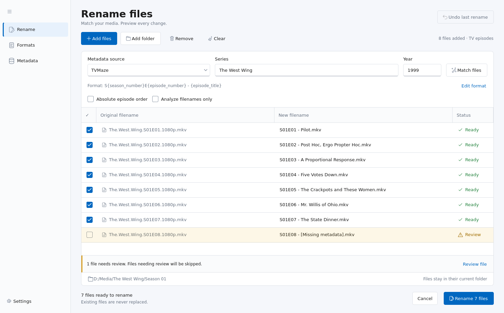
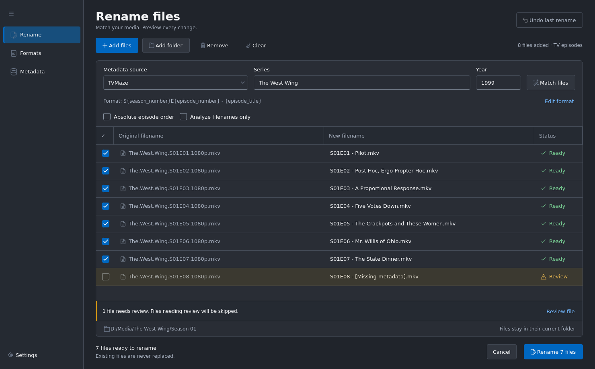

# Simpler FileBot 🗃️
This is a batch file-renaming GUI tool for movies and tv shows.

`Simpler FileBot is built using PySide6 and is designed with Windows 11 in mind!`

*Special thanks* to [guessit](https://github.com/guessit-io/guessit) for analyzing and providing the metadata for filenames.

## Requirements
**You might be able to skip this section if using the Executable installation option.**

- [Python 3.10 - 3.14](https://www.python.org/downloads/) - 
  `Installation help:` [[Windows](https://www.geeksforgeeks.org/how-to-install-python-on-windows/)] [[Mac](https://www.geeksforgeeks.org/how-to-install-python-on-mac/)] [[Linux](https://www.geeksforgeeks.org/how-to-install-python-on-linux/)]

  Make sure `pip` is installed and `Python` is added to your environment variables.

## Modern PySide6 UI

## Light & Dark Mode

## Installation
[Download Source Code](https://github.com/MirageOne/Simpler-FileBot/releases)

### Executable (Currently only for Windows)

- Download `Simpler-FileBot.exe` from the Releases section

- Run the executable

### Python

- `pip install -r requirements.txt`

- `py main.py`

### Windows
- `Run install_dependencies.bat`

- `Use launcher.bat to open Simpler FileBot`

## Windows builds

See [Windows build instructions](docs/windows-build.md) for local setup, portable ZIPs, the Inno Setup installer, and GitHub Actions artifacts.

## Rename workspace

The Fluent-style interface provides an editable preview table, inline metadata matching, and light/dark themes.
Windows supplies the native title bar; Windows 11 backdrop support is enabled when available. The UI remains built with PySide6.

1. Choose **Add files**, **Add folder**, or drop media into the table. Folder imports run in the background and can be cancelled.
2. Choose a metadata source and select **Match files**. Use **Local metadata** to work without an API connection.
3. Review the original and proposed names together. Double-click a new filename to edit it. Missing metadata, invalid names, and collisions are marked **Review** and skipped.
4. Check the files to include, then select **Rename**. Files stay in their original folders. **Undo last rename** also supports completed changes after a partial failure.

**Formats**, **Metadata**, and **Settings** are available from the navigation pane. API keys are configured on the Metadata page.
Keyboard shortcuts: **Ctrl+O** adds files, **Ctrl+Shift+O** adds a folder, **Alt+M** matches, **Delete** removes highlighted rows, and **Ctrl+Z** undoes the last rename.

## Supported Databases
`Simpler FileBot uses the following databases/APIs but is not endorsed, certified, or otherwise approved.`

  

[Source](https://www.tvmaze.com/) [[Python Library](https://github.com/yakupadakli/python-tvmaze)]

  

[Source](https://www.themoviedb.org/) [[Python Library](https://github.com/celiao/tmdbsimple/)] (Requires an API key at [Link](https://www.themoviedb.org/settings/api))

  

[Source](https://www.omdb.org/en/us) [[Python Library](https://github.com/dgilland/omdb.py)] (Requires an API key at [Link](https://www.omdbapi.com/apikey.aspx))

  

### `Simpler FileBot also supports matching solely using the guessit library.`
